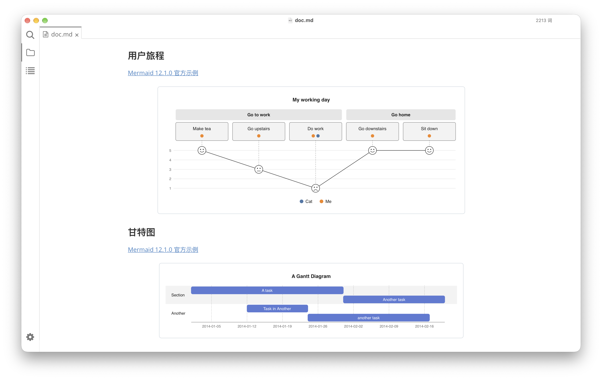
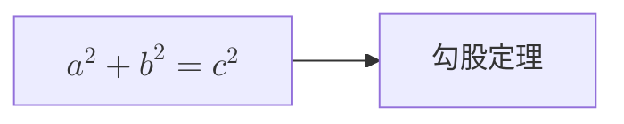

# Pele for Typora

在 Typora 中使用 **Pele** 渲染 Mermaid 图表。

[安装](#安装) · [开始使用](#开始使用) · [外观设置](#外观设置) · [反馈问题](https://github.com/hazuki-keatsu/typora-pele/issues)



基于 [Typora Community Plugin](https://github.com/typora-community-plugin/typora-community-plugin) 的社区插件，使用 [Pele](https://github.com/obsidianmd/pele) 接管 `mermaid` 代码块的渲染，支持 Mermaid v12.1.0 语法。

## 功能

- **快速渲染**：由于 **Pele** 的高性能，跳过 Typora 默认的 200 ms 渲染延迟（若图表过多，可在设置中关闭实时渲染）。
- **适应页面宽度**：调整编辑区域宽度时，重新布局并渲染图表。
- **亮暗主题**：根据编辑器背景亮度自适应调整主题，支持分别设置亮色、暗色主题。
- **数学标签**：通过 Typora 内置 MathJax 排版 `$$...$$` 公式。
- **HTML 导出**：将插件的图表样式一并写入导出文档。

## 安装

先安装 [Typora Community Plugin](https://github.com/typora-community-plugin/typora-community-plugin)，再安装本插件。

当前 manifest 声明的最低版本为 **Typora 1.6.7**、**插件核心 2.10.42**，目标平台为 Windows、Linux 和 macOS。*这不代表所有系统与版本组合都已完成验证，目前仅测试 `macOS 27 - Typora 1.14.15 (7789)`，如有问题，请开启 Issue。*

### 插件市场安装

1. 打开 [Typora Community Plugin](https://github.com/typora-community-plugin/typora-community-plugin) 全局设置（默认快捷键 `ctrl+.`）。
2. 在「插件市场」中找到 Pele，然后安装。
3. 在「已安装插件」中启用 Pele，然后重启 Typora。

### 手动安装

1. 从 [Releases](https://github.com/hazuki-keatsu/typora-pele/releases) 下载 `plugin.zip`。
2. 关闭 Typora，将压缩包解压到 `hazuki-keatsu.pele` 的文件夹，确保 `manifest.json` 和 `main.js` 位于该文件夹根目录。
3. 将文件夹放入 Typora-community-plugin 的插件安装目录（详情见[官方文档](github.com/typora-community-plugin/typora-community-plugin/blob/main/docs/zh-cn/user-guide/2-plugin-installation.md)）。
4. 重新打开 Typora，在社区插件设置的「已安装插件」中启用 **Pele**。

### 从源码构建

使用 `Node.js 24` 和 `pnpm 12` 构建，在项目根目录运行：

```sh
pnpm install
pnpm run pack
```

生成的 `plugin.zip` 位于项目根目录，按上述步骤安装即可。

## 开始使用

在 Typora 中插入一个语言为 `mermaid` 的代码块：

````markdown

````

启用插件后，已有的 Mermaid 代码块也会使用 Pele 渲染，禁用插件后恢复原有渲染器。

需要数学标签时，可以在节点中使用公式：

````markdown

````

更多图表与交互测试示例见 [示例文档](test/vault/doc.md)。

## 外观设置

在社区插件设置中打开 **Pele**，可调整实时渲染开关、亮色主题变量和暗色主题变量。变量自动保存并生效，留空使用默认配色。

每行填写一条 CSS 变量声明，无需包裹 `.pele` 选择器。例如：

```css
--pele-bg: #ffffff;
--pele-fg: #24292f;
--pele-accent: #5b7bd5;
--pele-border: #d1d9e0;
```

## 使用边界

- 图表语法和布局以当前集成的 **Pele 1.12.0** 为准，不保证与 Typora 原生 Mermaid 的所有行为一致。
- 公式排版依赖 Typora 的 MathJax。
- 插件依赖 Typora 的内部渲染接口，升级 Typora 后若出现异常，可先禁用插件恢复原有渲染器。

反馈问题时，请附上操作系统、Typora 与插件核心版本，以及能复现问题的最小 Mermaid 代码。

## 许可证与致谢

本项目采用 [MIT 许可证](LICENSE.md)。

感谢 [Pele](https://github.com/obsidianmd/pele) 提供 SVG 图表渲染能力，以及 [Typora Community Plugin](https://github.com/typora-community-plugin/typora-community-plugin) 提供插件基础设施。
